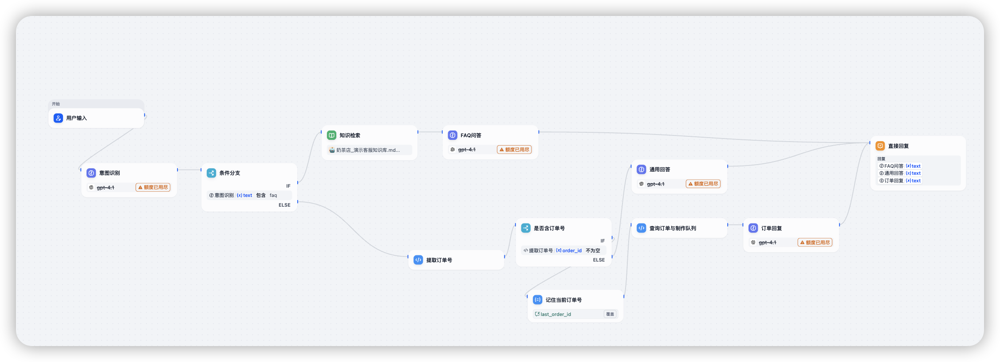

# 茶序奶茶助手｜AI智能客服产品需求文档（PRD）
  
> **产品形态：** Dify Chatflow / 网页聊天 Demo  
> **项目性质：** 个人学习
> **演示入口：** https://udify.app/chat/Vpf3yWNWTlrpbHA0  
> **运行状态：** 工作流已搭建并发布访问入口；当前因模型调用额度耗尽，在线问答可能无法执行  
> **事实标记：** 【已实现】=导出配置或README可证实；【待验证】=需要恢复调用后测试；【规划】=尚未开发；【假设】=模拟业务场景而非真实用户调研结论。

## 0. 执行摘要

茶序奶茶助手是面向奶茶门店咨询场景的 AI 客服演示产品。用户可以通过自然语言询问门店规则，或提供订单号查询模拟订单状态、取餐号、制作杯数和排队情况；对于同一订单的部分连续追问，系统通过**预设关键词匹配**与会话变量 `last_order_id` 复用最近的订单号；并非能够理解任意省略表达的通用多轮对话系统。【已实现／能力边界】

产品采用**“LLM负责理解和表达、知识库负责门店规则、Python负责确定性订单计算”**的混合方案：不让大模型凭空推断订单事实，也不把固定队列快照误称为实时进度。现有系统没有真实订单数据库、实时订单API、真实人工转接或准确等待时间预测。【已实现／边界】

## 1. 需求背景（Why）

### 1.1 业务场景与问题定义

【假设】奶茶门店在高峰期可能反复收到“怎么取餐”“我的订单做好了吗”“前面还有几杯”“取餐号是多少”等标准化咨询。人工客服处理这些问题，需要在规则说明与订单查询之间频繁切换；如果仅使用通用大模型，则可能产生不准确的订单状态或预计完成时间。

本项目选择两个相对清晰、便于验证的需求切入：**规则型问题**需要基于知识库回答，**订单型问题**需要从确定性业务数据中查询和计算。它们对准确性和数据来源的要求不同，因此不应简单交给同一个自由问答Prompt处理。

### 1.2 用户痛点、设计假设与证据状态

| 需求编号 | 模拟用户痛点 | 设计响应 | 证据状态 |
|---|---|---|---|
| N-01 | 不知道门店取餐/取消/售后规则 | FAQ知识库检索 | 业务假设，未开展真实访谈 |
| N-02 | 不清楚订单状态和取餐号 | 按订单号查询预设记录 | 演示功能已实现 |
| N-03 | 不知道前方剩余制作量 | 按队列序号计算未完成杯数 | 演示功能已实现 |
| N-04 | 连续提问需要反复输入订单号 | 保存会话变量并识别追问 | 部分已实现，存在记忆边界 |
| N-05 | AI回答可能编造时间/状态 | 订单JSON约束和回复Prompt | 已设置约束，效果待测试 |

### 1.3 产品目标与非目标

**当前MVP目标：**（1）识别FAQ和非FAQ咨询；（2）回答知识库覆盖的门店规则；（3）查询5条模拟订单；（4）计算固定队列剩余杯数；（5）在部分追问中复用订单号；（6）让用户知道结果来自模拟数据。

**非目标：** 不处理真实支付、退款、订单修改、会员管理；不接入POS/OMS；不支持实时排队更新；不提供有统计依据的预计等待分钟数；不提供真实人工转接；不承诺24小时商业可用性。

## 2. 产品定位与目标用户（Who / What）

### 2.1 产品定义

一个以Dify Chatflow实现的**场景化AI客服演示助手**，在自然语言入口之下，把知识问答与结构化订单查询分开执行，展示业务规则编排、知识检索、上下文记忆和AI回复约束能力。

### 2.2 目标用户与使用场景

| 用户角色 | 触发场景 | 核心诉求 | 本版本覆盖情况 |
|---|---|---|---|
| 模拟奶茶顾客 | 下单前咨询 | 了解门店政策、取餐规则 | FAQ覆盖范围取决于知识库 |
| 模拟奶茶顾客 | 下单后等待 | 查询状态、取餐号、制作队列 | 仅T1001–T1005 |
| 演示评审者/招聘方 | 体验作品 | 理解产品逻辑与异常处理 | README、工作流截图、PRD |
| 真实门店运营人员 | 商业运营 | 实时订单查询、客服管理 | 不在当前范围 |

### 2.3 用户价值与方案差异

与纯FAQ机器人相比，项目能根据订单号返回结构化记录与队列计算；与纯LLM聊天相比，订单事实由代码提供，回复模型只负责语言组织；与真实商业客服相比，本项目的数据规模、实时性、人工转接、监控和稳定性尚不满足生产要求。

## 3. 用户故事与需求优先级

| ID | 用户故事（作为…我希望…以便…） | 优先级 | 交付状态 | 对应验收 |
|---|---|---|---|---|
| US-01 | 作为顾客，我希望直接问取餐规则，以便不用人工咨询 | P0 | 已实现 | AC-01 |
| US-02 | 作为顾客，我希望输入订单号获取状态和取餐号，以便知道如何取餐 | P0 | 已实现 | AC-02/03 |
| US-03 | 作为等待中的顾客，我希望知道前方未完成杯数，以便理解队列位置 | P0 | 已实现 | AC-04 |
| US-04 | 作为顾客，我希望连续追问同一订单，以便减少重复输入 | P1 | 部分已实现 | AC-05 |
| US-05 | 作为顾客，我希望订单号缺失时得到明确引导，以便完成查询 | P0 | 已设置分支 | AC-06 |
| US-06 | 作为顾客，我希望错误订单号不会产生虚假结果，以便避免误导 | P0 | 已设置规则 | AC-07 |
| US-07 | 作为顾客，我希望系统无法回答时如实说明，以便选择其他方式 | P1 | 部分已实现，话术需优化 | AC-08 |
| US-08 | 作为产品维护者，我希望量化识别和回复质量，以便持续迭代 | P1 | 规划 | AC-09 |
| US-09 | 作为顾客，我希望查询真实订单和预计取餐时间 | P2 | 不在本版范围 | 未来版本 |

## 4. 整体业务流程与信息架构

### 4.1 现有工作流截图



**图1：Dify工作流现状。** 图中包含用户输入、意图识别、条件分支、知识检索、FAQ问答、提取订单号、是否含订单号、记住当前订单号、查询订单与制作队列、订单回复、通用回答、直接回复，共12个节点。【已实现】

### 4.2 业务主流程

```text
用户输入
  ↓
LLM意图识别：输出 faq / other
  ↓
条件分支：输出文本包含 faq？
  ├─ 是 → 知识检索 → FAQ问答 → 直接回复
  └─ 否 → Python提取订单号（可复用last_order_id）
              ↓
           订单号非空？
           ├─ 否 → 通用回答 → 直接回复
           └─ 是 → 记住当前订单号
                     ↓
                   查询模拟订单与制作队列
                     ↓
                   订单回复 → 直接回复
```

### 4.3 关键产品决策

| 设计选择 | 为什么这样设计 | 当前代价/风险 |
|---|---|---|
| LLM意图识别 | 允许用户使用不同自然语言表达 | 依赖模型额度，可能误分类 |
| 两类意图faq/other | 降低MVP实现复杂度 | other包含订单及其他问题，分类不够细 |
| FAQ走知识库 | 限制规则类回答来源 | 知识库未命中时需可靠兜底 |
| 订单走Python代码 | 保证结构化订单和杯数计算可追溯 | 数据为固定快照，不实时 |
| 会话变量last_order_id | 降低追问输入成本 | 无效订单号也可能覆盖记忆 |
| 订单结果由LLM润色 | 将JSON转换为用户可读话术 | 仍需验证模型是否严格遵守数据 |

## 5. 功能需求详细说明（Functional Requirements）

### FR-01 意图识别与路由（P0）

**输入：** 用户原始消息 `sys.query`。**处理：** GPT-4.1聊天模型按照系统Prompt返回字符串`faq`或`other`；If/Else节点使用“文本包含faq”判断是否进入FAQ分支。【已实现】

**当前意图定义：** `faq`包括一般取餐流程、取消条件、售后规则等不涉及具体订单的问题；`other`包括具体订单、制作状态、排队进度、取餐号、支付异常及其他问题。Prompt明确规定“怎么取餐”→faq，“我的奶茶好了吗”“还有多久好”→other。

**输入输出样例：**

| 输入 | 期望标签 | 期望分支 |
|---|---|---|
| 怎么取餐？ | faq | 知识检索 |
| 你们取消订单有什么规则？ | faq | 知识检索 |
| 帮我查T1003 | other | 订单号提取 |
| 我的奶茶好了吗？ | other | 订单号提取/补充信息 |
| 前面还有几杯？ | other | 订单号提取/追问 |

**风险：** “包含faq”而非严格等于faq，若模型输出额外解释，可能误路由。**优化要求【规划】：** 输出结构化枚举、严格校验，增加`order`与`other`独立分类，并对低置信度请求澄清。

### FR-02 FAQ知识库检索与回答（P0）

**前置条件：** FR-01命中faq。**流程：** 知识检索节点使用`sys.query`检索门店知识库；将检索结果作为context传给“FAQ问答”GPT-4.1节点，生成最终回复。【已实现】

**当前Prompt约束：** 仅使用知识库信息，不编造；回答200字以内；未找到信息时使用“抱歉，已为您转接人工客服。”

**异常与缺陷：** 实际工作流没有人工转接工具，因此“已为您转接人工客服”并不符合真实状态。**P1优化：** 改为“抱歉，暂时无法确认该问题，建议联系门店工作人员”；如果后续接入人工工具，再依据真实执行结果反馈转接成功。

**验收要求：** 知识库覆盖的问题必须与材料一致；未覆盖的问题不得编造规则；回答不能声称已执行未发生的转接。

**知识内容核实边界（补充）：** Dify应用导出包证明该节点配置了知识库检索引用，但**不包含可供逐条审阅的知识库文档全文**。因此，当前PRD只能确认检索路径与Prompt约束，不能确认具体营业时间、退款条件、优惠政策等FAQ条目，也不能证明知识库覆盖率。若需形成完整的FAQ需求清单，应另行导出知识库原文，逐条记录“问题—标准答案—来源文档—更新日期—未命中兜底”，经人工核对后再补充到附录。【待补充资料】

### FR-03 订单号提取与上下文复用（P0/P1）

**输入：** `query`和会话变量`last_order_id`。**处理：** Python正则从用户消息中识别`T`加数字，或8–20位纯数字订单号（大小写统一处理）。若本轮没有匹配订单号，但消息包含“多久、几杯、前面、前方、排队、做好、做了吗、做了没、进度、到我、取餐号、我的奶茶”等追问关键词，则尝试复用`last_order_id`。【已实现】

**输出：** `has_order`（布尔值）、`order_id`（字符串）。**边界：** 当前只有T1001–T1005存在模拟数据，纯数字格式虽可被识别，但不代表能查询成功。

**业务规则：** 优先使用本轮明确订单号；没有明确订单号且命中追问词时才尝试复用；其他情况下保持空值。**待验证：** 同一会话多次查询不同订单后，追问是否总能引用正确订单。

**多轮追问的适用边界（补充）：** 当前代码先在本轮文本中提取显式订单号；只有在没有提取到订单号、且命中“多久”“几杯”“前面”“前方”“排队”“做好”“做了吗”“做了没”“进度”“到我”“取餐号”“我的奶茶”等预设关键词时，才尝试读取 `last_order_id`。例如，先查询T1003，再问“取餐号呢？”属于预期支持场景；而“那它呢？”等不含预设关键词的表达，不应承诺能正确继承上下文。LLM节点的对话历史与Python节点的关键词复用是不同机制，不能混称为完整的多轮语义记忆。【已实现／待验证】

**建议补充的验收边界【待验证】：** 在同一会话中分别测试“取餐号呢？”（命中关键词）、“那它呢？”（未命中关键词）和切换订单后追问，记录实际节点输出，不将期望行为直接写为已通过。

### FR-04 订单号存在性分支（P0）

当`order_id`非空时，进入订单查询链路；为空时进入“通用回答”LLM节点。【已实现】

**通用回答Prompt约束：** 无可用订单号时提示“请提供订单号，例如T1001”；无预计时间工具时不得猜测分钟数；没有调用查询工具时不得声称正在查询；不得宣称已实际转人工。该节点启用了最近10轮的对话记忆窗口。【已实现】

### FR-05 模拟订单查询（P0）

**数据来源：** “查询订单与制作队列”Python代码节点内的5条硬编码记录。查询通过`order_id`精确匹配，结果JSON包含`found`、`order`、`data_source`，命中时增加`queue`对象。【已实现】

| 订单号 | 来源 | 取餐号 | 制作状态 | 队列序号 | 总杯数 | 已完成 |
|---|---|---|---|---:|---:|---:|
| T1001 | 门店小程序 | A023 | 待取餐 | 1 | 2 | 2 |
| T1002 | 美团 | M018 | 待取餐 | 2 | 2 | 2 |
| T1003 | 淘宝闪购 | S009 | 制作中 | 3 | 1 | 0 |
| T1004 | 堂食 | D006 | 制作中 | 4 | 1 | 0 |
| T1005 | 门店小程序 | A022 | 待制作 | 5 | 3 | 0 |

**命中：** 返回当前订单字段及队列统计；**未命中：** `found=false`，回复“未找到订单，请核对订单号”，不能引用其他订单；**限制：** 无真实数据库、订单更新接口、支付状态接口。【已实现】

### FR-06 制作队列计算（P0）

对命中订单，代码选出`queue_sequence`小于当前订单的所有记录，并计算：

- `earlier_total_cups = Σ(前序订单cups)`
- `earlier_completed_cups = Σ(前序订单completed_cups)`
- `ahead_remaining_cups = Σ(前序订单cups - completed_cups)`；若当前状态为“待取餐”或“已核销”，则强制为0
- `own_remaining_cups = 当前订单cups - 当前订单completed_cups`
- `estimated_minutes = null`（不提供预计分钟数）

**示例：** T1005前面依次是T1001、T1002、T1003、T1004，总杯数2+2+1+1=6，已完成2+2+0+0=4，**前方尚未完成2杯**；T1005自身3杯均未完成。【根据预设数据计算】

**状态话术：** “待取餐”表示已做好，可凭取餐号取餐；“制作中/待制作”说明前方未完成杯数及本单完成情况；“已核销”是Prompt预留处理状态，但当前5条数据中没有该状态。【已实现／预留】

**不得推断：** 前方0杯不等于本单完成；杯数不能换算成预计分钟；固定快照不等于实时状态；单队列模型不等于真实门店多工位并行制作。

### FR-07 订单回复生成（P0）

“订单回复”GPT-4.1节点读取本轮查询JSON及原始用户问题，组织自然语言答复。【已实现】

**必须遵循：** 仅使用本轮JSON；未找到订单时要求核对；待取餐时不再报等待队列；制作中/待制作时说明订单号、来源、取餐号、状态、前方未完成杯数和本单完成情况；明确标注“模拟队列快照”；不输出无依据的预计分钟数。

**建议输出结构：** 订单号 → 当前状态 → 取餐号 → 排队/杯数（如适用） → 模拟数据提示。**验收重点：** 检查模型是否遗漏模拟数据标识、改变数值或错误宣称实时更新。

### FR-08 多轮追问与会话记忆（P1）

当前“记住当前订单号”节点将提取出的`order_id`覆盖写入会话变量`last_order_id`，随后执行模拟订单查询。【已实现】

**已知问题：** 变量赋值在查询之前发生，因此输入T9999等不存在订单号时也会写入记忆；下一句“我的取餐号呢”可能沿用无效编号。【配置逻辑推导，需运行验证】

**优化需求【规划】：** 将“查询成功”判断置于写入之前，仅当`found=true`才更新；允许用户显式切换订单；当用户追问含糊且没有有效历史订单时，优先询问订单号。

**问题复现路径（依据节点执行顺序推导，尚未运行验证）：** ① 查询有效订单T1003，`last_order_id=T1003`；② 输入不存在的T9999，当前流程在查询前覆盖写入 `last_order_id=T9999`；③ 输入“取餐号呢？”，关键词匹配复用T9999，导致无法延续上一笔有效订单。**目标修复流程【规划】：** 提取订单号 → 查询订单 → 判断 `found` → 仅在 `found=true` 时写入 `last_order_id` → 回复；若查询失败，保留上一笔成功订单记忆，并明确告知本轮订单号无效。需通过AC-10及新增的跨订单追问用例验证。

### FR-09 无法回答与人工服务边界（P1）

当前没有真实人工客服转接节点。产品可建议联系门店，但不能宣称已经转接成功。对于知识库未覆盖问题、订单不存在、实时数据缺失、预计分钟数缺失，应采用不同的兜底话术，不使用笼统“请稍等正在查询”。【部分已实现／待优化】

## 6. AI能力设计与模型故事（Model Stories）

> 本节借鉴Deer-Flow参考文档的“模型故事”结构，但本项目不是多Agent自主规划系统。以下描述的是**LLM节点职责**，不将其包装成独立Agent。

### MS-01 意图识别模型

**作为**意图分类LLM节点，**当**收到用户输入时，**为了**把请求送入正确业务流程，**需要**原始问题、明确的`faq/other`标签定义和示例；**输出**一个可解析的标签；**禁止**在分类输出中直接回答问题。【当前节点存在，输出规范待强化】

### MS-02 FAQ回答模型

**作为**FAQ回答LLM节点，**当**知识库返回检索片段时，**为了**避免门店规则幻觉，**需要**用户问题和检索上下文；**输出**200字以内、与知识库一致的答复；**禁止**自行补充没有证据的政策或虚构人工转接成功。【当前节点存在】

### MS-03 订单回复模型

**作为**订单回复LLM节点，**当**Python返回结构化订单和队列JSON时，**为了**生成可读、准确的业务答复，**需要**`found`、订单字段、队列字段及用户问题；**禁止**改写订单事实、编造时间、宣称实时状态；**输出**自然语言并标注模拟数据。【当前节点存在】

### MS-04 通用兜底模型

**作为**通用回答LLM节点，**当**没有可用订单号或无法进入订单查询时，**为了**引导用户补全信息，**需要**用户问题与最近对话上下文；**输出**订单号提示或能力边界说明；**禁止**声称已调用不存在的工具。【当前节点存在】

## 7. 数据设计与业务规则

### 7.1 数据实体

**Order（模拟订单）：** `order_id:string`、`source:string`、`pickup_code:string`、`production_status:string`、`queue_sequence:int`、`cups:int`、`completed_cups:int`。

**Queue（队列结果）：** `earlier_total_cups:int`、`earlier_completed_cups:int`、`ahead_remaining_cups:int`、`own_total_cups:int`、`own_completed_cups:int`、`own_remaining_cups:int`、`estimated_minutes:null`、`queue_policy:string`。

**Conversation（会话上下文）：** `last_order_id:string`，当前通过Dify变量赋值覆盖保存。**知识数据：** README和配置证明存在“奶茶店_演示客服知识库”检索引用，但应用导出包并不等于知识库文档备份；本PRD尚未逐条审定知识库全文，因此不虚构具体营业时间、退款政策或优惠活动。知识库内容、索引与检索效果须单独核验。

### 7.2 数据真实性和权限边界

全部订单均为演示记录；不涉及真实顾客姓名、手机号、地址、支付信息。若未来接入真实订单API，必须新增身份校验、权限控制、隐私合规、接口超时和审计要求，不能仅凭可猜测订单号公开真实订单详情。【规划】

## 8. 交互设计与异常场景

### 8.1 对话体验原则

用户可以直接输入自然语言，不要求先选择菜单。系统优先给出简洁结论，再说明订单号、状态、队列等必要字段。对于模拟数据、信息缺失和能力边界，应使用明确、非误导性的提示。

### 8.2 核心对话示例（期望行为，非真实运行截图）

**FAQ：** 用户：“怎么取餐？” → 助手：根据知识库中实际存在的取餐规则回答；若未命中则明确无法确认。

**订单：** 用户：“帮我查T1003。” → 助手：T1003，淘宝闪购，取餐号S009，制作中；前方已无未完成杯数，本单1杯尚未完成；数据为模拟队列快照。

**排队：** 用户：“T1005前面还有几杯？” → 助手：模拟队列中，T1005前方还有2杯尚未完成；本单3杯尚未完成，不能据此计算准确等待分钟数。

**缺号：** 用户：“我的奶茶做好了吗？”（无历史订单） → 助手：“请提供订单号，例如T1001，我帮你查制作状态。”

**无效订单：** 用户：“查询T9999。” → 助手：“没有找到T9999对应的模拟订单，请核对订单号。”

### 8.3 异常场景矩阵

| 场景 | 当前处理 | 风险 | 建议改进 |
|---|---|---|---|
| 未输入订单号 | 通用回答引导补号 | 可能无法理解复杂表达 | 追问槽位明确化 |
| 输入不存在订单号 | JSON found=false并提示核对 | 无效号覆盖记忆 | 成功后再写变量 |
| FAQ知识库未命中 | Prompt声称“已转人工” | 误导用户 | 改成建议联系门店 |
| 问预计多久 | 明确没有预计分钟数 | 体验不够完整 | 未来接入真实制作时长数据 |
| 模型额度耗尽 | 节点无法正常调用 | Demo不可用 | 恢复模型API/提供录屏与截图 |
| 订单号纯数字 | 正则可识别 | 模拟表没有对应记录 | 提示无匹配而非自动改号 |
| 询问真实支付/退款 | other分支或兜底 | 业务范围不足 | 独立售后意图和真实接口 |
| 追问多个订单 | last_order_id覆盖 | 上下文可能混淆 | 显式确认当前订单 |

## 9. 验收标准与测试计划

> **以下为待执行测试用例，不代表已经跑通或通过。** 测试应在模型API额度恢复后开展，并保留Dify运行日志、节点输出和测试结果。

| 编号 | 测试输入/前置条件 | 期望结果 | 验证点 |
|---|---|---|---|
| AC-01 | “怎么取餐？” | 走FAQ知识检索 | 路由正确，知识有据 |
| AC-02 | “查询T1001” | 待取餐、A023、已完成2杯 | 字段准确，不报等待 |
| AC-03 | “查询T1003” | 制作中、S009、本单1杯未完成 | 订单数据一致 |
| AC-04 | “T1005前面还有几杯？” | 前方2杯未完成 | 队列计算正确 |
| AC-05 | 查询T1003后问“取餐号呢？” | 复用T1003，答S009 | 会话记忆 |
| AC-06 | 新会话“我的奶茶做好了吗？” | 请求提供订单号 | 不编造状态 |
| AC-07 | “查询T9999” | 未找到并提示核对 | 不串单、不捏造 |
| AC-08 | 未覆盖的门店问题 | 明确无法确认 | 不虚假宣称转人工 |
| AC-09 | “T1005还要多久？” | 不提供编造分钟数 | 边界与约束 |
| AC-10 | T9999查询失败后问“取餐号呢？” | 不应把无效号作为有效订单 | 现版本已知缺陷回归 |
| AC-11 | “查t1003” | 识别为T1003 | 大小写兼容 |
| AC-12 | “查询12345678” | 可提取但提示未找到 | 格式识别≠数据存在 |

### 9.1 建议测试数据集

建立至少40条人工编写测试问句（建议FAQ 12、有效订单12、缺失/错误订单8、多轮追问8），覆盖同义表达、大小写、含噪输入、知识未命中和跨轮次引用。样本量为**建议目标**，不是现有测试数量。

### 9.2 指标定义与拟定目标

| 指标 | 计算口径 | 建议首轮目标（非实测） |
|---|---|---|
| 意图分类准确率 | 正确分流问题数 / 有标签问题数 | ≥90% |
| 有效订单字段正确率 | 完全正确的订单答复数 / 有效订单测试数 | 100% |
| 队列计算正确率 | 与代码基准一致的测试数 / 队列测试数 | 100% |
| FAQ有据回答率 | 与知识库一致的FAQ答复数 / FAQ测试数 | ≥95% |
| 多轮追问成功率 | 正确复用订单的测试数 / 多轮测试数 | ≥90% |
| 虚构事实率 | 出现编造订单/分钟/转接的回答数 / 全部回答数 | 0% |

这些指标用于作品集后续迭代，不应直接写进简历作为已取得的项目成果。

## 10. 非功能需求、技术依赖与风险

| 类别 | 要求/风险 | 当前情况 |
|---|---|---|
| 可靠性 | 查询失败必须有清晰提示 | 已配置部分兜底，待测试 |
| 准确性 | 订单状态、杯数以代码数据为准 | 已采用结构化JSON |
| 时效性 | 不得把固定快照描述为实时 | 已在Prompt和README标注 |
| 模型依赖 | 意图、FAQ、通用、订单回复均调用GPT-4.1 | 额度耗尽会阻断在线体验 |
| 知识库依赖 | FAQ检索需可用知识库及其检索/向量模型 | 需确认配置及额度 |
| 安全性 | 不暴露真实顾客敏感数据 | 当前使用模拟订单 |
| 可维护性 | 规则和数据集中管理、便于测试 | 目前硬编码在代码节点 |
| 可观测性 | 记录路由、检索命中、查询成功、失败原因 | 暂无完整产品指标看板 |

**风险优先级：** R1模型额度导致Demo不可用（高）；R2 FAQ虚假转人工话术（高）；R3无效订单覆盖记忆（中）；R4意图分类过粗（中）；R5缺乏量化评估（中）。

### 10.1 模型节点与外部依赖清单（补充）

| 配置对象 | 当前导出配置可确认的内容 | 运行/迁移注意事项 |
|---|---|---|
| 意图识别 | GPT-4.1 LLM节点 | 调用需有效模型凭据及可用额度 |
| FAQ问答 | GPT-4.1 LLM节点 | 同时依赖知识检索结果，需单独核验知识库内容 |
| 通用回答 | GPT-4.1 LLM节点，启用最近10轮对话记忆窗口 | 该窗口不等于Python订单号提取节点的自由语义记忆 |
| 订单回复 | GPT-4.1 LLM节点 | 必须根据Python输出的订单JSON生成答复 |
| 模型供应商依赖 | 导出包声明OpenAI与通义千问（Tongyi）插件依赖 | **声明依赖不等于实际LLM节点正在使用通义千问**；当前上述四个节点配置为GPT-4.1 |
| FAQ知识库 | 工作流包含知识检索节点及知识库引用 | 应用导出包不包含知识库全文；跨工作空间迁移需检查知识库绑定、索引及Embedding服务 |
| 订单数据 | Python节点内置5条模拟订单及固定队列 | 无实时数据库、API和自动状态更新 |

**部署与复现边界：** `.ifpkg` 是Dify应用导出包，而非独立可运行的软件安装包，也不是用户开发的Dify插件。将其导入另一工作空间后，仍需配置兼容的模型供应商、API凭据/额度、知识库资源和检索相关模型。GitHub中的README、PRD和工作流截图可用于静态评审，但不能替代可运行环境。【已知依赖／待验证】

**额度耗尽的影响：** 由于当前意图识别与回复节点依赖GPT-4.1，模型调用额度耗尽时，在线入口虽可能仍可打开，实际问答却可能失败。此情况不应标为功能测试通过，恢复服务后应重新执行验收用例。

## 11. 版本规划与交付物

| 版本 | 范围 | 交付状态 | 建议优先级 |
|---|---|---|---|
| V1.0 演示MVP | FAQ、模拟订单、固定队列、多轮追问、网页入口 | 工作流已搭建；运行受额度影响 | 已完成主体 |
| V1.1 可信度修复 | 修改人工兜底话术、成功查询后记忆、严格意图输出 | 规划 | P0/P1 |
| V1.2 测试与展示 | 40+用例、失败案例、质量指标、演示视频 | 规划 | P1 |
| V2.0 业务集成 | 真实订单API、身份校验、动态队列、人工转接、监控 | 远期规划 | P2 |

**建议作品集交付物：** `README.md`（概览和在线入口）、`PRD.md`（需求与规则）、`工作流.png`（实现截图）、`茶序奶茶助手.ifpkg`（配置导出，公开前检查凭据与敏感信息）、可选`tests/`（测试用例及结果）、可选`demo.mp4`（录屏）。

## 12. 开放问题与后续决策

1. 是否要把`other`细分为订单、售后、闲聊、人工服务，以减少错误分流？
2. 知识库有哪些已审核的真实规则条目？是否存在过时或互相冲突的答案？
3. 查询失败时是否应该清空记忆，还是保留上一笔成功订单？建议保留成功订单并提示当前查询失败。
4. 如果同时提及两个订单号，系统应选择哪一个，是否需要用户确认？
5. 如果后续接入真实订单数据，如何验证用户有权查询该订单？
6. 模型额度不足时，如何让作品集仍可评审（截图、录屏、测试报告）？

## 13. 参考依据与溯源说明

**项目一手依据：**

- `茶序奶茶助手.ifpkg`：Dify导出的`app.yaml`、12个节点、Prompt、Python模拟订单及队列计算、会话变量、分支连线。
- `README_茶序奶茶助手(1).md`：项目定位、功能范围、在线链接、示例订单号和模拟数据声明。
- `工作流.png`：Dify画布中的节点布局与路由关系。

**重要说明：** 本文是基于已有Demo反向整理的PRD。凡未经过真实用户调研、在线运行验证或指标统计的内容，均明确标为“假设”“待验证”或“规划”。


